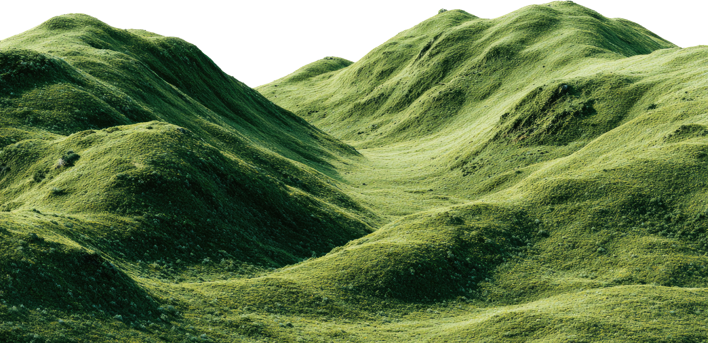
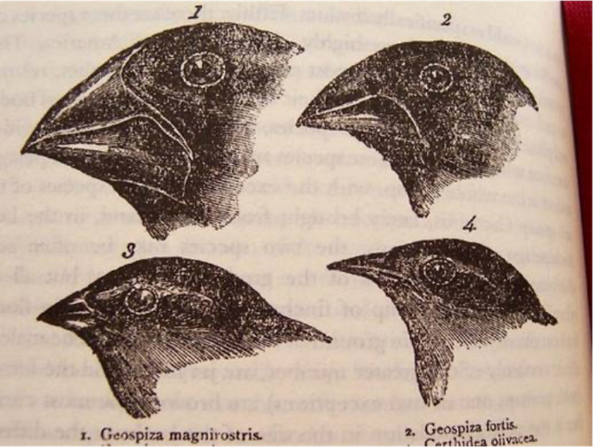
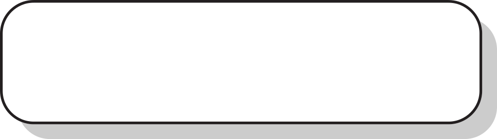
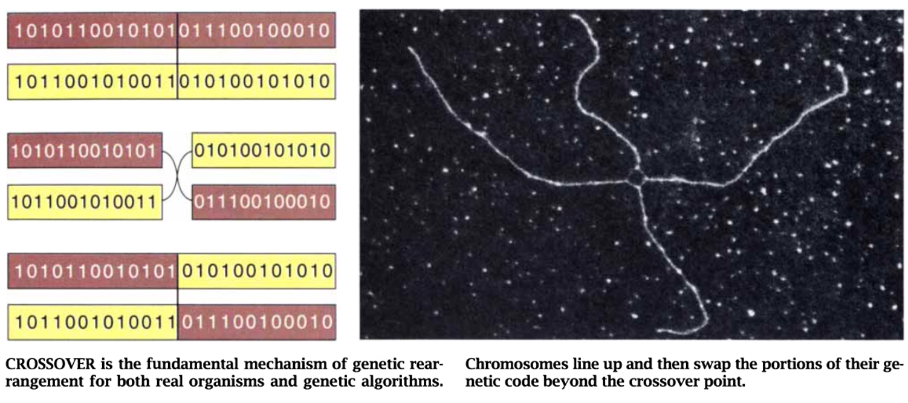
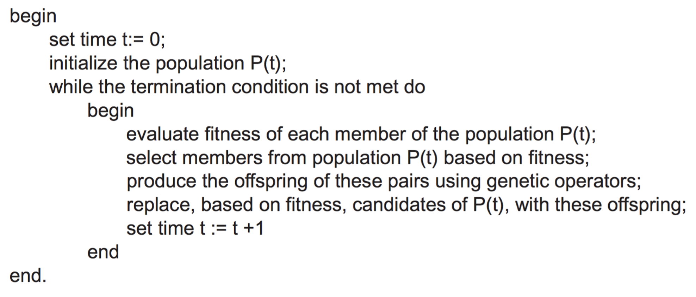

<!--
Week 10 Session A. Mini-lecture budget: 25 minutes.
Source: 04_Optimization.pptx slides 1-7. Beats per lesson plan:
local search (5) → hill climbing + 3 failure modes (7) → simulated annealing (5)
→ GAs as a design space (8).
THE SOURCE DECK JUMPS STRAIGHT TO EVOLUTIONARY COMPUTATION. Hill climbing and
simulated annealing are ADDED here — without them GAs look like magic rather than
one point in a design space. Lesson plan: ../../weeks/week-10.md
-->

# Optimization and Biology-Inspired Agents

## Giving up guarantees on purpose

**CMP-4004** · Week 10


---

# A* is optimal. Why use anything else?

Because optimality has preconditions you cannot always meet:

- The state space may be **continuous** — there are no discrete neighbors to
  enumerate
- It may be **too large to enumerate** at all
- You may not *need* the optimum — you need a good answer **in ten seconds**

> ## Optimality is a luxury you sometimes cannot afford.

That is legitimate engineering, not defeat. It reframes the entire second half of
this course.

---

# Local search

Keep **one** current state. Move to a neighbor. Keep no path memory.

| | |
|---|---|
| Space | **constant** |
| Continuous spaces | **yes** |
| Completeness | **no** |
| Optimality | **no** |
| Returns | a **state**, not a route |

### The problem type changed

Weeks 3–9: *find a path.* Now: **find a good state.** If you need the route, local
search is the wrong tool — and noticing that distinction is half of choosing
correctly.

<!--
5 min. Make the path-vs-state point explicitly. Students carry the week-3 mental
model in and are confused when the algorithm returns no path.
-->

---

# The landscape



**Global maximum** · **Local maximum** · **Global minimum**

Optimization seeks global maxima or minima **and avoids confusing them with local
ones.**

Everything in this week and the next is a different strategy for not getting stuck
on the wrong hill.

---

# Hill climbing and its three failure modes

```
while True:
    best_neighbor = argmax(value, neighbors(state))
    if value(best_neighbor) <= value(state):
        return state          # ← stuck. But stuck how?
    state = best_neighbor
```

| Failure mode | What it looks like | Why gradient thinking fails |
|---|---|---|
| **Local optimum** | every neighbor is worse, and you are not at the best | the signal says stop, and it is wrong |
| **Plateau / shoulder** | neighbors are **equal** | **no gradient information at all** |
| **Ridge** | improving requires a **combination** of moves | no single move improves |

### The fixes, and their costs

random restarts *(embarrassingly parallel; wastes all previous work)* ·
stochastic hill climbing · first-choice hill climbing · **simulated annealing**

<!--
7 min. Mark the three modes on the landscape figure from the previous slide.
Payoff in live coding: steepest-ascent on 8-queens succeeds ~14% of the time;
ALLOWING SIDEWAYS MOVES ON PLATEAUS takes it to ~94%. One change to plateau
handling, six-fold improvement. Understanding the failure mode told you the fix.
-->

---

# Simulated annealing

Metals cooled **slowly** form good crystals. Cooled fast, they lock in defects.
Kirkpatrick, Gelatt & Vecchi (1983) turned that into an algorithm.

# accept a worse move with probability `exp(−ΔE / T)`

| Temperature | `exp(−ΔE/T)` | Behavior |
|---|---|---|
| high T | → 1 | accepts almost anything — **random walk** |
| low T | → 0 | accepts almost nothing — **hill climbing** |

> ## SA interpolates between random search and greedy search.
> ## The cooling schedule chooses where you are on that line, at each moment.

### The guarantee, stated honestly

With a **sufficiently slow** schedule, SA converges to the global optimum with
probability 1. "Sufficiently slow" means *slower than you can afford* — so in
practice you have **no** guarantee.

<!--
5 min. That last box is a scorecard axis 2 lesson: a theorem that is true and
practically unreachable is a different thing from a theorem you can rely on.
Students should be able to make that distinction crisply by week 10.
-->

---

# Evolutionary computation



Arose from the need to solve **combinatorial optimization** problems using the
principles of biological evolution.

| Year | Who | Contribution |
|---|---|---|
| 1960 | **Lawrence J. Fogel** | evolution of finite-state machines |
| 1970 | **Rechenberg & Schwefel** | evolutionary strategies for parameter optimization |
| 1975 | **John H. Holland** | **genetic algorithms** as a general adaptive model |

---

# The biological analogy — and what it buys



- **Adaptation** — the ability to survive and behave appropriately relative to the
  environment
- **Heredity** — passing traits to a new generation
- **Natural selection** — the fittest are more likely to pass on their traits

### The move that makes it an algorithm

> If we treat **every point in a function's solution space as an individual**, we
> can evaluate its fitness and run an evolutionary process in which only
> individuals converging on global optima survive.

**And the structural difference from SA:** SA keeps *one* candidate. A GA keeps a
**population** — which enables an operator SA cannot have.

---

# Genetic algorithms


Holland. Natural selection applied to computation: **variation · selection ·
heredity**.

| Concept | Encoding |
|---|---|
| **Individual** | a bit string |
| **Chromosome** | a sequence of 1s and 0s — a point in the solution space |
| **Evaluation** | a **fitness function** |
| **Reproduction** | **crossover** |
| **Variation** | **mutation** — flip a bit with some probability |

---

# Crossover and mutation



## Crossover

Parents exchange bit sections **at the same position**. Generalizes to
single-point, two-point, or *k*-point.

## Mutation

Each bit may flip, according to a probability.

**Crossover is the operator a population buys you.** It combines information from
two solutions — something no single-candidate method can do. Whether it actually
helps on a given problem is an empirical question, and Task 2 of the studio
answers it with an ablation.

---

# A GA is a design space, not an algorithm

| Component | Options | Consequence |
|---|---|---|
| **Representation** | bit string, permutation, real vector | determines which operators are **legal** |
| **Fitness** | the objective, or a transform | scaling affects selection pressure |
| **Selection** | roulette, tournament, rank | **pressure vs. diversity** |
| **Crossover** | 1-point, *k*-point, uniform, order-based (OX) | **must preserve validity** |
| **Mutation** | bit flip, swap, Gaussian | maintains diversity; **rate is critical** |
| **Replacement** | generational, elitist, steady-state | elitism prevents losing the best |

## ⚠️ The trap waiting in Task 1

**For TSP, standard one-point crossover produces invalid tours** — repeated
cities. Permutation problems need **order crossover (OX)** or PMX.

<!--
8 min for the GA slides. Tell them about the OX trap now and let them hit it
anyway — but provide validate_tour() so they detect invalidity immediately
instead of debugging fitness for 15 minutes.
-->

---

# Exploration vs. exploitation



Every parameter in that table is really a knob on **one** trade-off.

- Too much selection pressure → **premature convergence**. The population becomes
  a clone and improvement stops.
- Too little → **never converges**. You have paid for a random search.

### We will demonstrate both, live

| Mutation rate | Outcome |
|---|---|
| **0.0** | population collapses to a clone, stops improving. *Diversity is not optional.* |
| **0.5** | becomes random search, never converges |

The parameters are not decoration. **They select the algorithm's actual behavior.**

---

# Next: live coding

1. **Hill climbing failing** — 100 random starts on 8-queens, ~14 % success. Then
   allow sideways moves: **~94 %**.
2. **Simulated annealing** — plot the accepted-value trace. Wild early, settling
   late.
3. **A GA on knapsack** — then break it twice with the mutation rate.

## Studio — a real hyperparameter study

population (20, 50, 100) × mutation (0.001, 0.01, 0.1) × tournament (2, 5),
**five seeds each**, **fixed evaluation budget**.

> ### Fixed *evaluations*, not fixed *generations*.
>
> Population 100 for 50 generations and population 20 for 250 generations are the
> same compute. Comparing at equal generations **silently favors large
> populations.**

**Every result needs error bars.** A stochastic algorithm reported from one run is
not a result.

<!--
Honest result to prepare for in Task 1: 2-OPT HILL CLIMBING OFTEN BEATS A NAIVE
GA ON TSP AT EQUAL BUDGET. Do not hide it. A GA is not automatically better for
being biologically inspired, and discovering that is worth more than a tidy win.
No LLM comparison this week, by design — week 11 does it with a full
budget-normalized bake-off, and today's methodology is what makes that honest.
-->
